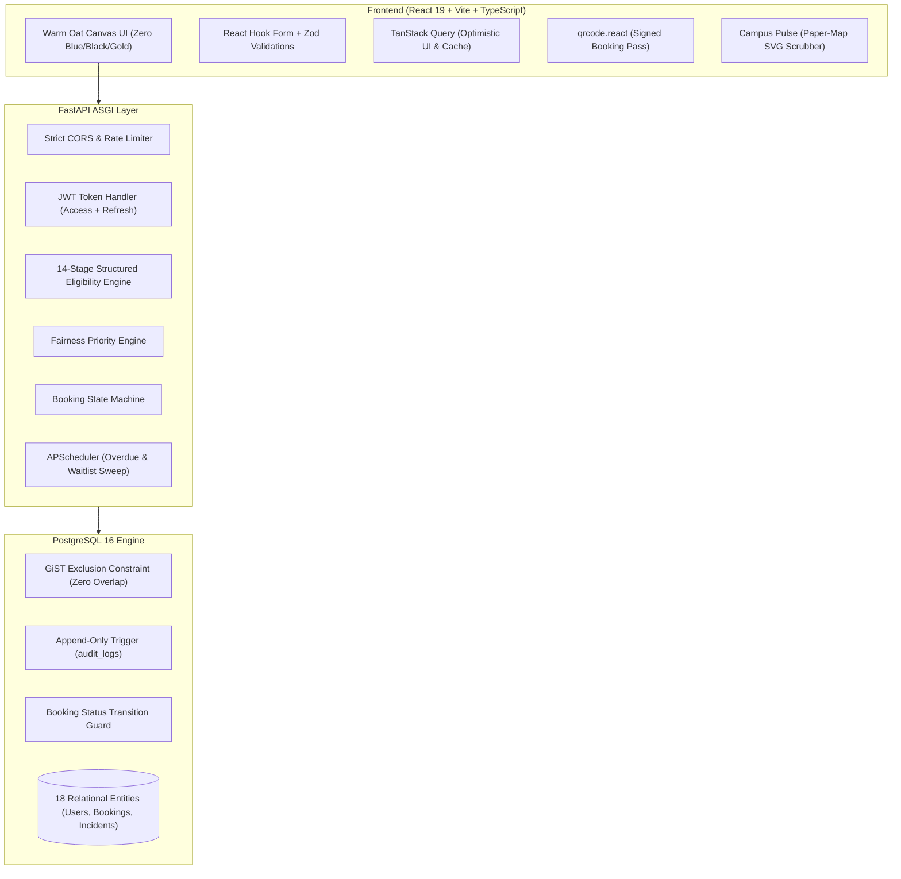
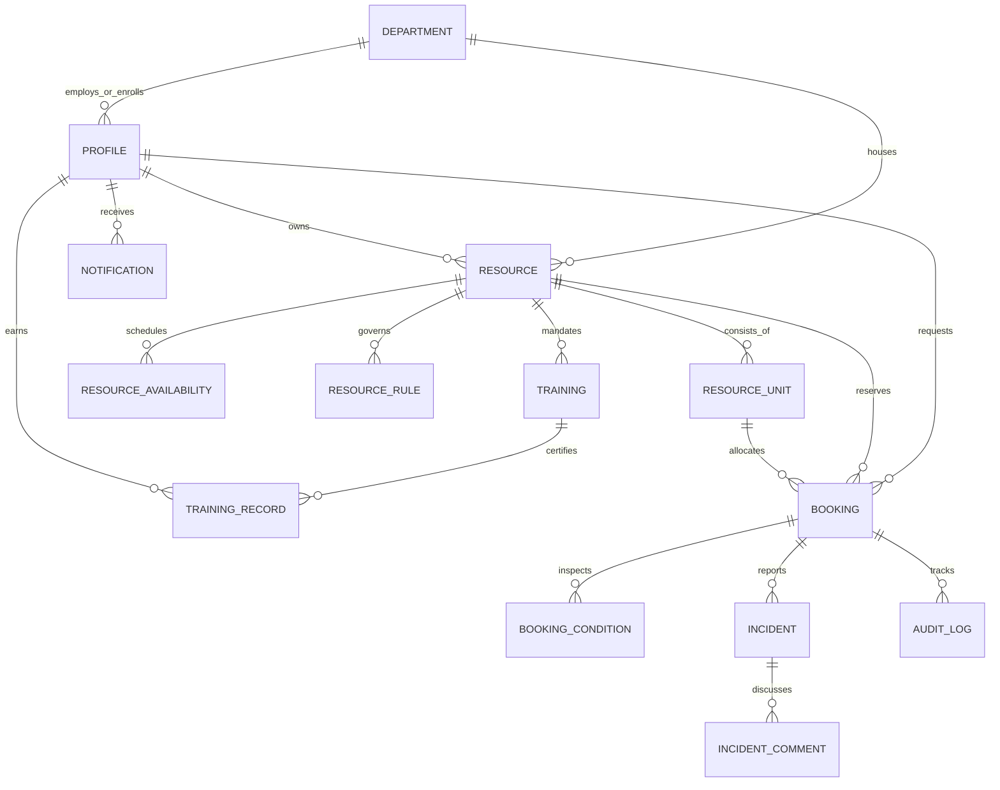

# CampusShare 🏛️
> *"Every Resource Deserves Utilization. Every User Deserves Fair Access."*

CampusShare is an intelligent, cross-departmental campus resource sharing platform built for institutional research facilities and academic equipment. It maximizes resource utilization while enforcing mathematical fairness, strict physical accountability, cryptographic handover verification, and immutable auditing.

---

## 🎯 Problem & Solution

### The Institutional Problem
Across university campuses, specialized departmental assets (such as 4K cinema cameras, deep-learning GPU workstations, high-frequency oscilloscopes, and seminar halls) sit idle up to **72% of the calendar year**. Simultaneously, students and interdisciplinary researchers in other departments face weeks of friction, opaque gatekeeping, double-bookings, untracked equipment damage, and zero recourse when resources are monopolized by privileged seniors.

### The CampusShare Solution
1. **Multi-Factor Algorithmic Fairness**: Replaces subjective approvals with a transparent, configurable priority scoring formula ($w_N \cdot N + w_D \cdot D + w_E \cdot E + w_A \cdot A$) that balances non-usage, academic need, safety certification, and wait times.
2. **Deterministic Concurrency & Zero Double-Bookings**: Backed by PostgreSQL GiST exclusion constraints (`tstzrange` overlap prevention) and row-level locking (`SELECT FOR UPDATE`).
3. **Cryptographic Physical Accountability**: Every approved booking receives a signed, time-limited QR Booking Pass. Custody handover records condition photos and staff signatures; returns enforce verification with side-by-side photographic comparison.
4. **Autonomous State Machine & Immutable Auditing**: Every status transition follows an append-only audit trail protected by database triggers. Illegal state jumps or tampering attempts are blocked at the database layer.
5. **Campus Pulse & AI Project Buddy**: Interactive paper-map spatial floor plan visualizing live room utilization and an AI assistant that matches natural-language project descriptions to available lab resources.

---

## 🏗️ Architecture & Data Model

### System Architecture


### Entity-Relationship Diagram (ERD)


---

## 🛠️ Tech Stack

| Layer | Technologies | Key Highlights |
| :--- | :--- | :--- |
| **Frontend** | React 19, TypeScript, Vite 8 | Zero third-party UI component libraries; hand-crafted design tokens on Oat canvas (`#FBF9F5`); Recharts telemetry; Lucide icons; `qrcode.react`. |
| **State & API** | TanStack Query v5, React Hook Form, Zod | Typed API client with automatic JWT token refresh, dry-run live booking validation (`POST /bookings/validate`), optimistic cache invalidation. |
| **Backend** | Python 3.12+, FastAPI, Pydantic v2 | High-throughput asynchronous REST API; row-locking transactions; automated background scheduler (APScheduler). |
| **Database** | PostgreSQL 16 (Neon / Alpine) | `btree_gist`, `pg_trgm`, `pgcrypto` extensions; mathematical exclusion constraints; PL/pgSQL append-only security triggers. |
| **Security** | PyJWT, bcrypt, rate-limiting | HTTP-only credentials, IDOR shields, multi-tenant RBAC guards, signed QR tokens, 5MB image upload type verification. |
| **DevOps** | Docker, Docker Compose, Nginx, Vercel, Render | Single-command local startup (`docker-compose up`); free-tier Render cold-start wake-up splash. |

---

## 🚀 Running Locally

### Option A: Single Command via Docker Compose (Recommended)
Spins up PostgreSQL, Backend (with automated Alembic migrations and database seed), and Frontend:
```bash
docker-compose up --build
```
- **Frontend**: [http://localhost:3000](http://localhost:3000)
- **Backend API Docs**: [http://localhost:8000/docs](http://localhost:8000/docs)
- **Health Check**: [http://localhost:8000/health](http://localhost:8000/health)

---

### Option B: Manual Setup (Two Terminals)

#### 1. Backend Setup
```bash
cd backend
python -m venv venv

# Windows:
venv\Scripts\activate
# macOS / Linux:
source venv/bin/activate

pip install -r requirements.txt

# Run migrations, database triggers, and seed demo records:
alembic upgrade head
python scripts/seed.py

# Start FastAPI server:
uvicorn app.main:app --reload --port 8000
```

#### 2. Frontend Setup
```bash
cd frontend
npm install
npm run dev
```
Visit [http://localhost:5173](http://localhost:5173) in your browser.

#### 3. Run Backend Verification Test Suite
```bash
cd backend
pytest tests -v
```
*Executes all 60 tests covering 10 hackathon scenarios, GIST exclusion, security hardening, and E2E journeys.*

---

## 🔑 Demo Credentials Table

All demo accounts share the password: **`Campus@123`** (Auto-fill chips available on the Login screen).

| Persona | Email | Name | Role | Department | Key Capabilities to Test |
| :--- | :--- | :--- | :--- | :--- | :--- |
| **Student 1 (Trained)** | `student1@campusshare.demo` | Aarav Mehta | `STUDENT` | Electronics | Validated in DSLR + 3D Printing. Has active booking ready for pickup (`CS-2026-00042`). |
| **Student 2 (Untrained)** | `student2@campusshare.demo` | Diya Patel | `STUDENT` | Computer Science | Untrained in DSLR to test real-time training rejection. |
| **Student 3 (High Need)** | `student3@campusshare.demo` | Kabir Shah | `STUDENT` | Media & Design | Fresh account with 0 recent bookings; verifies highest fairness score priority. |
| **Lab Owner** | `owner@campusshare.demo` | Ritu Nair | `OWNER` | Media & Design | Manages DSLR kits, audio mics, projectors. Performs QR handover check-out & return inspection. |
| **Facility Manager** | `manager@campusshare.demo` | Dr. Sunita Rao | `MANAGER` | Mechanical Eng | Reviews approval queues, resolves damage incidents, monitors department statistics. |
| **Institutional Admin** | `admin@campusshare.demo` | System Admin | `ADMIN` | Computer Science | Full institutional oversight, live fairness weights simulator, one-click demo data reset. |

---

## ⏱️ 5-Minute Judge Walkthrough Script

### Minute 1: The Public Portal & "Try Demo Account"
1. Open [http://localhost:5173/login](http://localhost:5173/login).
2. Click the **"Student 2 (Untrained)"** chip to auto-fill credentials, then sign in.
3. Browse the Marketplace, click **"Canon EOS DSLR Camera Kit"**.
4. Observe the **Live Eligibility Checklist**: Green ticks for account standing, but a prominent Red Cross on **Safety Certification**: *"Mandatory DSLR equipment training has not been completed."*
5. Attempting to book triggers an informative 409 alert with suggested free alternative slots.

### Minute 2: Student 1 Requests & Manager Approves
1. Sign out and sign in using the **"Student 1 (Trained)"** chip.
2. Select Canon DSLR; notice all 14 eligibility checks evaluate Green.
3. Submit a booking request for an open slot. Status enters `PENDING` with computed priority score.
4. Sign in as **"Facility Manager"** (`manager@campusshare.demo`).
5. Open **Approval Queue** (`/approvals`). Review Student 1's request with conflict analysis. Click **Approve**.
6. Switch back to Student 1: open **Notifications** (`/notifications`) to see the instant approval alert.

### Minute 3: Cryptographic QR Handover & Inspection
1. As Student 1, open **My Bookings** (`/my-bookings`). Click the approved booking to open the **Booking Pass Drawer** with its cryptographically signed QR code.
2. Sign in as **"Lab Owner"** (`owner@campusshare.demo`).
3. Navigate to **Handover Screen** (`/handover`). Enter or scan the booking code.
4. Inspect unit condition (marked `EXCELLENT`), verify photo upload, and click **Complete Check-Out**.
5. Booking status transitions to `CHECKED_OUT`.

### Minute 4: Return & Damaged Incident Triage
1. Sign in as Student 1: Click **Submit Return**, attach note *"Returned with scratched front UV filter"*, and submit $\to$ Status becomes `RETURN_PENDING`.
2. Sign in as Lab Owner: Navigate to **Return Verification** (`/returns`). Compare pickup vs return photos side-by-side.
3. Select Condition: `DAMAGED`. Mark damage observed with description: *"UV filter scratched"*. Click **Confirm Return & Report Incident**.
4. Booking updates to `INCIDENT_REPORTED`, and physical unit is automatically marked `DAMAGED` (removed from fleet availability).
5. Sign in as Facility Manager: Navigate to **Incident Review** (`/incidents`), inspect the evidence thread, add resolution comments, and close the incident.

### Minute 5: Campus Pulse & Admin Reset
1. Sign in as **"Administrator"** (`admin@campusshare.demo`).
2. Open **Campus Pulse** on the Analytics dashboard. Drag the **Hour Scrubber (08:00 - 20:00)** across Blocks A, B, and C to watch room occupancy heatmaps update dynamically.
3. Open **Platform Settings** (`/admin/settings`). Adjust the Fairness Weight sliders ($w_N, w_D, w_E, w_A$) and watch the simulator recalculate priority scores.
4. Click **"Reset Demo Data"** to restore factory demo records with a single click.

---

## ⚖️ Algorithmic Fairness Formula

CampusShare rejects first-come-first-served bias in favor of multi-factor equity:

$$\text{Priority Score} = w_N \cdot N + w_D \cdot D + w_E \cdot E + w_A \cdot A$$

Where the weights satisfy $\sum w = 100$:

| Factor | Component | Range | How it Shifts Priority |
| :--- | :--- | :---: | :--- |
| **$N$** | **Non-Usage Factor** | $0.0 - 1.0$ | **Prevents Hoarding**: Students with fewer booked hours over the last 30 days receive higher priority scores. |
| **$D$** | **Academic Need Match** | $0.2 - 1.0$ | **Purpose Alignment**: Capstone and thesis projects ($1.0$) score above extracurricular club activities ($0.5$). |
| **$E$** | **Departmental Alignment**| $0.5 - 1.0$ | **Affiliation**: Students enrolled in the resource's home department receive full weight ($1.0$); cross-campus users receive $0.75$. |
| **$A$** | **Waitlist Seniority** | $0.0 - 1.0$ | **Fair Waiting**: Logarithmic scaling of elapsed queue wait time guarantees persistent students eventually rise to the top. |

*Administrators can tune weights live via the Admin UI, which are saved in `platform_settings` and audited.*

---

## 🛡️ Security Model & Threat Mitigations

| Threat Vector | Mitigation Strategy | Enforcement Mechanism |
| :--- | :--- | :--- |
| **Concurrent Double-Bookings** | PostgreSQL GiST exclusion constraint (`tstzrange` overlap) + `SELECT FOR UPDATE`. | Database engine level (returns 409 Conflict + suggested free slots). |
| **Audit Log Tampering** | PostgreSQL append-only database trigger strictly disallowing `UPDATE` and `DELETE`. | `BEFORE UPDATE OR DELETE ON audit_logs` raises security violation. |
| **Illegal State Jumps** | Central `BookingStateMachine` + DB trigger preventing unauthorized status jumps. | Disallows jumping directly from `PENDING` to `COMPLETED`. |
| **IDOR & Horizontal Escalation** | Multi-tenant ownership checks in service layers and route guards. | Students cannot access another user's private bookings or incident evidence. |
| **Privilege Escalation** | Role-based dependency injection (`require_roles([ADMIN])`). Registration forces `STUDENT` role. | Users cannot self-assign `ADMIN` or `MANAGER` in request payloads. |
| **File Upload Abuse** | Strict extension whitelist (`.jpg`, `.png`, `.webp`), MIME inspection, 5MB size ceiling. | `UploadService` validates bytes before disk write or CDN transfer. |
| **SQL Injection** | Parameterized SQLAlchemy ORM queries; input validation via Pydantic schemas. | Tested with payload strings (`' OR 1=1 --`); safely escaped. |
| **Brute-Force Attacks** | In-memory sliding-window IP rate limiting (5 consecutive failures blocks login for 15 min). | Returns 429 Too Many Requests. |

---

## 📋 Hackathon Acceptance Criteria Checklist

- [x] **Zero Double-Bookings**: PostgreSQL GiST exclusion constraint blocks overlapping slots for all physical units.
- [x] **14-Stage Eligibility Engine**: Structured evaluation returns plain-English reason and suggested free slots on failure.
- [x] **Live Booking Validation**: `POST /bookings/validate` provides real-time dry-run feedback in the UI.
- [x] **Multi-Unit Fleet Support**: Individual units tracked (`ARD-001`, `ARD-002`) with independent condition states.
- [x] **Accountability Modules**: Handover check-out, condition recording, return inspection, side-by-side photographic triage.
- [x] **Incident Lifecycle**: `REPORTED` $\to$ `UNDER_REVIEW` $\to$ `RESOLVED` $\to$ `CLOSED` with comment discussions and penalty logging.
- [x] **Campus Pulse Heatmap**: Stylized SVG paper-map rendering Blocks A, B, C with 08:00--20:00 time scrubber.
- [x] **AI Project Buddy Assistant**: Semantic recommendation matching natural language project goals to campus resources.
- [x] **Full 60-Test Automated Pytest Suite**: 100% green coverage across all 10 hackathon scenarios, security, and E2E journeys.
- [x] **Strict Design Palette Compliance**: Zero blue, zero black, zero gold across the entire UI and CSS tokens.
- [x] **Cold-Start Resilience**: Frontend `/health` ping and automated wake-up banner for sleeping Render instances.
- [x] **One-Click Demo Data Reset**: Audited admin endpoint to restore factory demonstration state.

---

## 🔮 Known Limitations & 2-Week Roadmap

While CampusShare is fully functional, production deployment across a 30,000-student university campus would benefit from the following extensions:

1. **Hardware RFID / NFC Scanner Integration**: Currently supports QR tokens and web camera feeds. With 2 more weeks, integrate WebUSB NFC reader hardware for physical student ID cards at lab turnstiles.
2. **WebSocket Live Push Telemetry**: Real-time push updates for approval notifications and live floor plan occupancy via WebSockets/SSE (currently utilizes TanStack Query polling intervals).
3. **Automated Equipment Maintenance Schedules**: Automatic preventative maintenance triggers based on cumulative hours checked out (e.g., laser cutter lens calibration every 200 hours).
4. **Multi-Campus Multi-Tenancy**: Expanding beyond a single university to support cross-university consortium sharing across regional higher-education networks.
